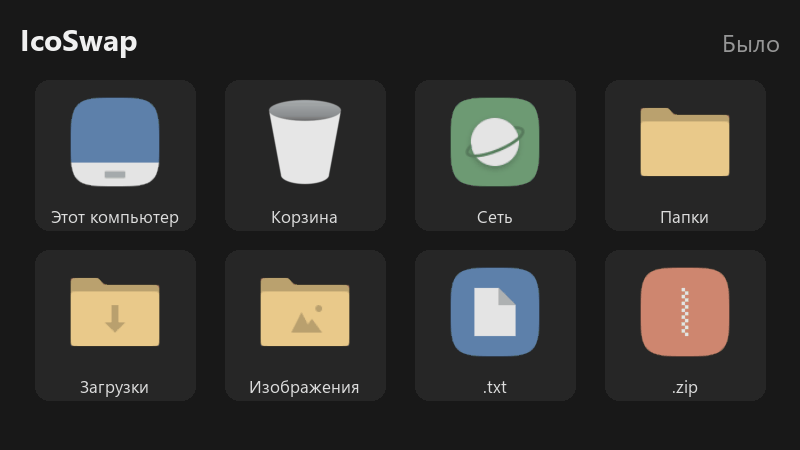
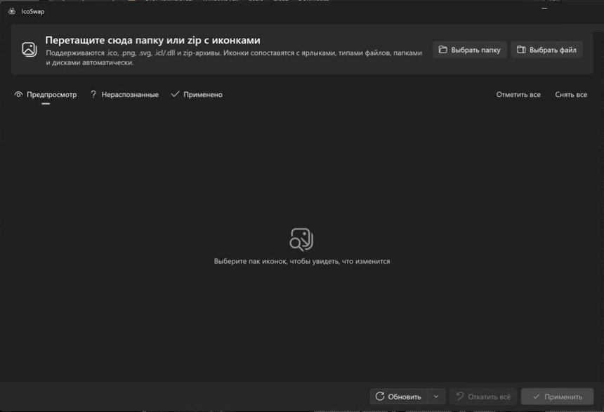

<p align="center">
  
</p>

<h1 align="center">IcoSwap</h1>

<p align="center">
  Смена иконок Windows 11 в один клик — замена IconPackager и 7TSP.<br>
  <a href="https://github.com/llLz-tSix/IcoSwap/releases/latest"><b>⬇ Скачать portable-версию</b></a> · без установки · .NET и Windows App SDK внутри
</p>

<p align="center">
  
</p>

Укажите папку (или zip) с иконками — IcoSwap сам поймёт, какая иконка к чему относится, покажет превью «было → станет» и применит. Всё откатывается одной кнопкой.

<p align="center">
  
</p>

* **Системные файлы не патчатся.** `imageres.dll`, `shell32.dll` и т.п. не трогаются; используются только штатные механизмы: свойства ярлыков, `desktop.ini`, ключи реестра в `HKCU`.
* **Права администратора не нужны**, кроме двух случаев: иконка «всех папок» и ярлыки в общем меню «Пуск» / на общем рабочем столе. Для них появится запрос UAC, остальное применяется без него.
* **Бэкап до любого изменения.** Перед первым изменением объекта его исходное состояние сохраняется в `%APPDATA%\IcoSwap\backups\state.json` (ярлыки и `desktop.ini` — побайтово). «Откатить всё» и откат отдельного пункта возвращают именно его.

## Как пользоваться

1. Запустите `IcoSwap.exe`.
2. Перетащите в окно папку или zip с иконками (или нажмите «Выбрать папку» / «Выбрать файл» — подходят zip, `.icl`, `.dll`).
3. Во вкладке **Предпросмотр** проверьте список: слева текущая иконка, справа новая. Снимите галочки с того, что менять не нужно.
4. Во вкладке **Нераспознанные** — иконки, которые не удалось сопоставить. Нажмите на иконку, чтобы назначить её вручную: ярлыку, системному значку, диску, любой папке или расширению (`.log`).
5. Нажмите **Применить**. Если где-то осталась старая иконка (чаще всего — закреплённые на панели задач, «Корзина», диски), нажмите **Обновить ▸ Глубокая очистка кэша**: Проводник перезапустится, кэш иконок сбросится.
6. Вкладка **Применено** — всё, что изменено, с откатом по пункту. **Откатить всё** возвращает систему в исходное состояние.

Можно открыть пак сразу: `IcoSwap.exe "D:\Icons\MyPack"`.

## Что меняется

| Что | Как | Права |
|---|---|---|
| Ярлыки `.lnk` (рабочий стол, «Пуск», закреплённые на панели задач) | `IconLocation` через `IShellLink` | пользователь; общие «Пуск»/рабочий стол — админ |
| Интернет-ярлыки `.url` (игры Steam и т.п.) | `IconFile` в файле ярлыка | пользователь |
| Типы файлов (`.txt`, `.zip`, `.pdf`, `.docx`…) | `HKCU\Software\Classes\<ProgID>\DefaultIcon` | пользователь |
| «Этот компьютер», «Корзина» (пустая/полная), «Сеть», «Файлы пользователя», «Панель управления» | `HKCU\…\Explorer\CLSID\{…}\DefaultIcon` | пользователь |
| Документы, Загрузки, Изображения, Музыка, Видео, Рабочий стол, любая папка | `desktop.ini` (`IconResource`) + атрибут папки | пользователь |
| Диски `C:`, `D:`… | `HKCU\Software\Classes\Applications\Explorer.exe\Drives\<буква>\DefaultIcon` | пользователь |
| Иконка всех обычных папок (закрытая / открытая) | `HKLM\…\Explorer\Shell Icons` (3 и 4) | админ |

После применения вызывается `SHChangeNotify` и `ie4uinit -show`, поэтому большинство изменений видно сразу.

## Формат пака

Пак — это папка или zip. Поддерживаются:

* `.ico` — используется как есть;
* `.png`, `.bmp`, `.jpg`, `.gif`, `.tif` и `.svg` — автоматически конвертируются в многоразмерный `.ico` (16, 20, 24, 32, 40, 48, 64, 128, 256 px; неквадратные картинки центрируются; SVG рендерится отдельно в каждом размере);
* `.icl` и `.dll` — библиотеки иконок из старых паков (32-битные PE и 16-битные NE `.icl`). Каждая группа иконок становится отдельной иконкой с именем ресурса (например `CHROME`) или `<библиотека>_<номер>`.

Пак копируется в `C:\ProgramData\IcoSwap\packs\<имя>_<хэш>` и продолжает работать, даже если исходную папку удалить.

> Почему `ProgramData`, а не `%APPDATA%`: если IcoSwap запущен из приложения в MSIX-контейнере (например, из окна некоторых IDE или помощников), Windows незаметно перенаправляет его запись в `%APPDATA%` в личную папку контейнера. Проводник этих файлов не видит, и ярлыки становятся белыми. `ProgramData` так не перенаправляется. Папку пака создаёт обычный пользователь, права администратора не нужны. Бэкапы лежат в `%APPDATA%\IcoSwap\backups`.

### Светлый и тёмный варианты

Многие паки содержат два комплекта: `Day`/`Night`, `Light`/`Dark` (или `светлая`/`тёмная`) в разных подпапках. IcoSwap берёт вариант под текущую тему Windows (Параметры ▸ Персонализация ▸ Цвета ▸ «Режим Windows»): при тёмной — `Night`/`Dark`, при светлой — `Day`/`Light`. Если сменили тему, загрузите пак заново и нажмите «Применить»: исходные иконки в бэкапе при этом сохраняются.

### Имена файлов

Имя файла без расширения нормализуется: регистр, `-`, `_`, пробелы, `CamelCase`, суффиксы размеров (`chrome_256`, `folder-48x48`, `icon@2x`) и слова вроде `icon`, `logo`, `ярлык` не важны. Работают русские и английские названия.

| Цель | Примеры имён |
|---|---|
| Этот компьютер | `this-pc`, `computer`, `my-computer`, `мой компьютер` |
| Корзина пустая | `recycle-bin`, `recycle-bin-empty`, `trash`, `user-trash`, `корзина` |
| Корзина полная | `recycle-bin-full`, `trash-full`, `user-trash-full`, `корзина полная` |
| Сеть | `network`, `network-workgroup`, `сеть` |
| Файлы пользователя | `user`, `user-home`, `пользователь` |
| Панель управления | `control-panel`, `панель управления` |
| Документы / Загрузки / Изображения / Музыка / Видео / Рабочий стол | `documents`, `folder-documents`, `downloads`, `загрузки`, `pictures`, `music`, `videos`, `desktop`… |
| Все папки | `folder`, `папка`; открытая — `folder-open` |
| Диски | `drive-c`, `disk-c`, `диск c`; все локальные — `drive`, `hdd`; `system-drive`; `usb`, `removable`; `cd`, `dvd` |
| Типы файлов | `txt`, `file-pdf`, `pdf-file`, `application-pdf`, `image-png` |
| Ярлыки программ | `chrome`, `google-chrome`, `firefox`, `vscode`, `telegram`, `steam`, `discord`, `spotify`… — сравниваются с именем ярлыка и именем exe, есть словарь синонимов на ~100 популярных программ и нечёткое сравнение |

Подпапки пака работают как подсказки: `drives\c.png` = диск C:, `folders\documents.png` = папка «Документы», `filetypes\txt.png` (или `extensions\`, `types\`) = расширение `.txt`.

Если одно имя подходит под несколько видов целей, приоритет такой: системные значки и папки → диски → типы файлов → ярлыки. Поэтому `documents.png` поменяет папку «Документы», а не случайный ярлык с таким именем.

### manifest.json (необязательно)

Кладётся в корень пака и уточняет или переопределяет автосопоставление:

```json
{
  "name": "My Icon Pack",
  "author": "Me",
  "map": {
    "star.png": "system:thispc",
    "box.ico": ["ext:.zip", "ext:.7z", "ext:.rar"],
    "hdd-red.png": "drive:C",
    "hdd.png": "drive:fixed",
    "games.png": "folder:D:\\Games",
    "browser.png": ["shortcut:Google Chrome*", "exe:msedge.exe"],
    "old.icl#3": "folder:generic",
    "old.icl#CHROME": "exe:chrome.exe"
  },
  "ignore": ["preview.png", "readme.png"]
}
```

Ключ `map` — путь к файлу относительно корня пака (или просто имя файла; для библиотек — `файл.icl#номер` или `файл.icl#ИМЯ`). Значение — одна цель или список:

| Цель | Значение |
|---|---|
| `system:<ключ>` | `thispc`, `recyclebin-empty`, `recyclebin-full`, `network`, `userfiles`, `controlpanel` (понимает и синонимы: `system:корзина`) |
| `folder:<ключ>` | `desktop`, `documents`, `downloads`, `pictures`, `music`, `videos`; `generic` — все папки; `open` — открытая папка; или полный путь `folder:D:\\Games` |
| `path:<папка>` | любая папка, можно с переменными окружения: `path:%USERPROFILE%\\Projects` |
| `drive:<что>` | буква (`C`), `all`, `fixed`, `removable`, `optical`, `system` |
| `ext:<.расширение>` | `ext:.txt` |
| `shortcut:<имя>` | имя ярлыка, поддерживаются `*` и `?` |
| `exe:<файл.exe>` | все ярлыки, запускающие этот exe |

Иконки, указанные в манифесте, автоматически не сопоставляются; файлы из `ignore` пропускаются.

## Ограничения Windows 11 (и как их обойти)

* **Иконки запущенных программ на панели задач** Windows берёт из окна/exe самой программы. Изменить это без внедрения в чужие процессы или патча exe нельзя, IcoSwap этого не делает. Закреплённые на панели задач кнопки берут иконку из ярлыка в `…\Quick Launch\User Pinned\TaskBar` — его IcoSwap меняет; после применения может понадобиться «Глубокая очистка кэша».
* **Приложения Microsoft Store** (Блокнот, Фото, Калькулятор, Параметры) показывают в «Пуске» иконку из своего пакета. Ярлыки на рабочем столе для них поменять можно, плитку в «Пуске» — нет.
* **Типы файлов с ProgID «на несколько расширений».** Иконка пишется в ProgID, поэтому если, например, `.jpg` и `.png` открываются одной программой, смена иконки одного затронет оба. В превью для таких пунктов есть пометка «Общий тип с: …».
* **Типы с иконкой «из содержимого»** (`.exe`, `.ico`, `.lnk`, файлы с IconHandler) не меняются — их иконка берётся из самого файла.
* **Диски, зашифрованные BitLocker**, Проводник всегда показывает со своей иконкой с замком — пользовательская иконка диска для них не отображается. IcoSwap определяет такие диски и по умолчанию снимает с них галочку.
* **Системные значки** («Корзина», «Этот компьютер», «Сеть»…) пишутся в тот же ключ `HKCU`, что и в стандартном окне «Параметры значков рабочего стола». Но Проводник Windows 11 держит эти иконки в своём кэше и подхватывает изменение не сразу: на проверочной машине новая «Корзина» появилась после перезапуска Проводника, но повторить это стабильно не удалось. В панели навигации и адресной строке иконка «Этот компьютер» осталась прежней. Если значок не обновился — «Глубокая очистка кэша» или выход из системы и повторный вход.
* **Иконка всех папок** (`Shell Icons`) — общесистемная настройка в `HKLM`, поэтому нужны права администратора и перезапуск Проводника. Если не хотите UAC — снимите с этого пункта галочку и назначайте иконки конкретным папкам.
* **Кэш иконок.** Ярлыки, типы файлов и папки обычно обновляются сразу. Для «Корзины» и закреплённых на панели задач нужна «Обновить ▸ Глубокая очистка кэша»: Проводник корректно закрывается, кэш очищается (`ie4uinit -ClearIconCache` и удаление `iconcache_*.db`, если их не держат другие программы), Проводник запускается снова.

Проверено на этой машине (Windows 11 26200): ярлыки на рабочем столе и в «Пуске», `.url` из Steam, закреплённые на панели задач, тип файлов `.docx`, папка «Загрузки» — меняются; «Корзина» поменялась один раз, но не стабильно (см. выше); диски не меняются из-за BitLocker. Откат возвращает всё побайтово.

## Консольный режим

`icoswap-cli.exe` лежит рядом с `IcoSwap.exe`:

```
icoswap-cli scan <папка|zip|icl>          что на что заменится
icoswap-cli apply <пак> [--no-admin] [--filter <regex по Id цели>]
icoswap-cli status                         применённые изменения
icoswap-cli rollback --all | <id>…         откат
icoswap-cli refresh [--deep]               обновить Проводник
icoswap-cli convert <in.png|svg> <out.ico> конвертация в многоразмерный .ico
```

## Сборка

Нужно: Windows 10 1809+ / Windows 11, [.NET 8 SDK](https://dotnet.microsoft.com/download/dotnet/8.0) (x64). Visual Studio не обязательна; Windows App SDK скачивается из NuGet автоматически.

```powershell
dotnet build IcoSwap.sln                     # сборка
dotnet test tests\IcoSwap.Core.Tests         # юнит-тесты (сопоставление, конвертация, бэкап/откат)
powershell -ExecutionPolicy Bypass -File tools\publish.ps1   # portable-версия
```

Результат `tools\publish.ps1`: папка `publish\IcoSwap\` (запускать `IcoSwap.exe`, установка не нужна — .NET и Windows App SDK внутри) и архив `publish\IcoSwap-portable-win-x64.zip`.

`tools\docs\make_gifs.py` собирает гифки для README из кадров окна, `tools\docs\extract-system-icons.ps1` вытаскивает стандартные значки Windows для анимации «было → стало».

`tools\make-assets.ps1 -Cli <путь к icoswap-cli.exe>` заново генерирует иконку приложения (из `Assets\IcoSwap.svg`) и тестовый пак `samples\TestPack` (20 иконок: PNG, SVG, ICO, подпапки, manifest.json).

### Структура

```
src/IcoSwap.Core     логика без UI: пак, конвертация, .icl, каталог целей, сопоставление, применение, бэкап
src/IcoSwap.App      WinUI 3 (Fluent, светлая/тёмная тема по системе), drag&drop, превью
src/IcoSwap.Cli      консольный режим
tests/               xUnit-тесты Core
samples/TestPack     тестовый пак
tools/               генерация ассетов, publish, снимок состояния для проверки отката
```

Зависимости: Microsoft.WindowsAppSDK, Svg (рендер SVG), System.Drawing.Common; в тестах — xUnit.
